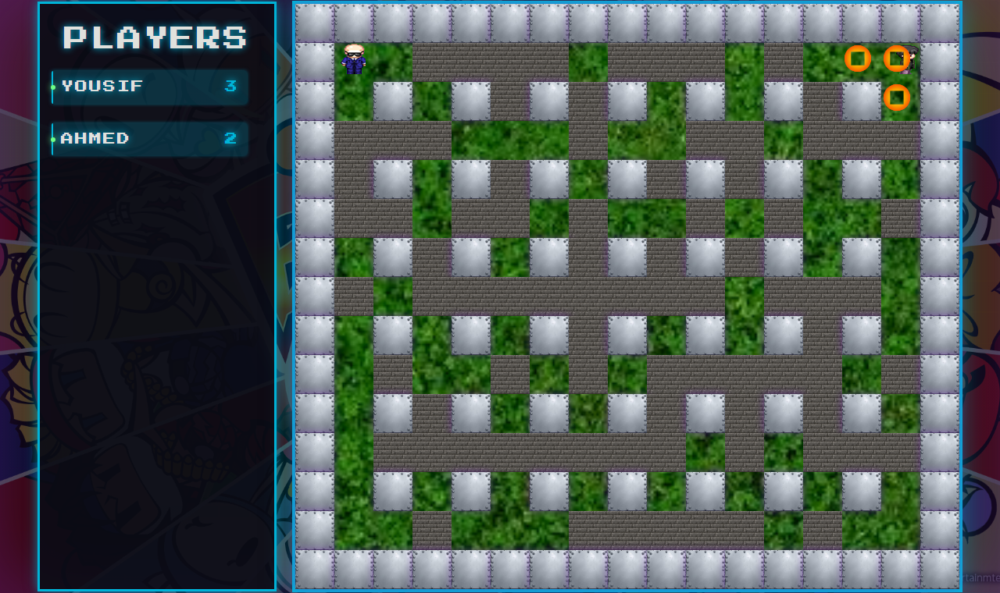
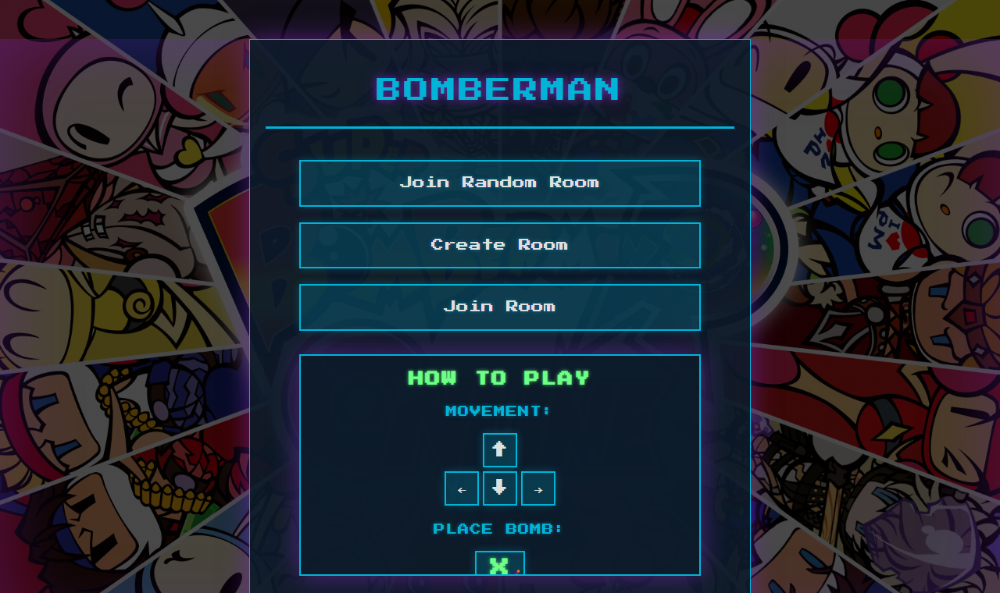
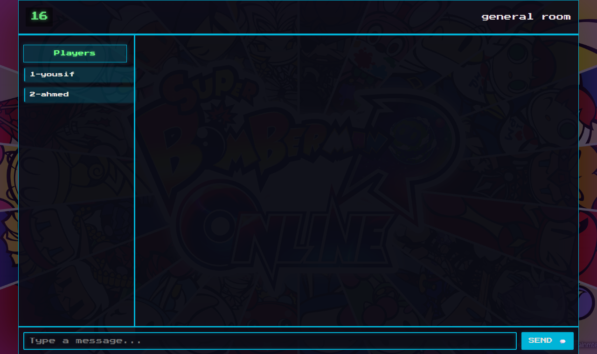

# Bomberman DOM

A real-time **multiplayer Bomberman** game for 2–4 players, rendered entirely with DOM elements (no canvas, no WebGL). The UI is built on a custom [mini-framework](https://github.com/ahmed-jawher/mini-framework), and game state is synchronized through a Node.js + Socket.IO server.




## Features

- **Real-time multiplayer** for 2–4 players per room over WebSockets
- **Rooms**: join a random room, create a private room, or join one with its room code
- **Lobby with chat**: players can talk while waiting, and a 20-second countdown starts once at least two players have joined
- **Server-authoritative gameplay**: the server validates movement, bombs and explosions, then broadcasts the results to every client
- **Randomly generated map** with indestructible blocks and destructible walls
- **Power-ups** hidden under walls:
  - **Bombs**: place one more bomb at a time
  - **Flames**: increase the blast range (up to 4)
  - **Speed**: move faster (up to 3)
- **3 lives per player**, with a live scoreboard; the last player standing wins
- Players are handled correctly when they leave mid-game or disconnect

## How to Play

| Key | Action |
|---|---|
| `↑` `↓` `←` `→` | Move |
| `X` | Place a bomb |

## Getting Started

**Requirements:** Node.js 16+ (or Docker)

```bash
git clone https://github.com/ahmed-jawher/bomberman-dom.git
cd bomberman-dom/server
npm install
npm start
```

Open <http://localhost:3000> in two or more browser windows to play.

### Run with Docker

```bash
docker build -t bomberman-dom .
docker run -p 3000:3000 bomberman-dom
```

## Screenshots

| Main menu | Lobby | In game |
|---|---|---|
|  |  |  |

## Architecture

```text
 Browser (mini-framework UI)              Node.js server
 ┌───────────────────────────┐   socket   ┌──────────────────────────┐
 │ components/  game screens │ ◄────────► │ server.js   Socket.IO hub │
 │ gameLoop/    input, bombs │   events   │ moduls/     rooms, players│
 │ socket/      client events│            │ movement/   map, moves    │
 └───────────────────────────┘            │ bomb/       blasts, lives │
                                          └──────────────────────────┘
```

Main socket events: `join-room`, `message`, `timer`, `map`, `moving`, `bomb`, `explode`, `lives` and `leaveRoom`.

## Project Structure

```text
bomberman-dom/
├── Dockerfile
├── server/
│   ├── server.js            # HTTP + Socket.IO server (port 3000)
│   ├── controllers/         # login, room creation, static files
│   ├── moduls/              # Room, Player, lobby countdown, leaving
│   ├── movement/            # map generation and move validation
│   ├── bomb/                # explosions and lives
│   └── routes/ service/     # routing and helpers
└── web/
    ├── framework1/          # mini-framework used by the UI
    └── bomberman/
        ├── main.js
        ├── components/          # nickname, menu, chat, game board
        ├── gameLoop/            # input manager, player movement, bombs
        ├── socket/              # client socket handlers
        └── styles/
```

## Author

**Ahmed Jawher** — [@ahmed-jawher](https://github.com/ahmed-jawher)
